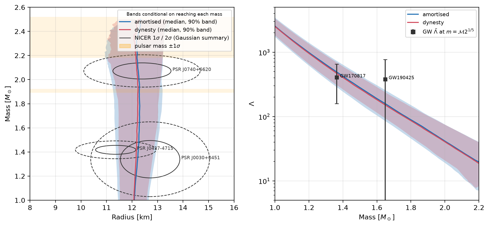
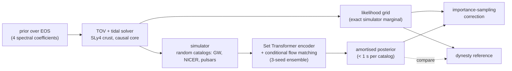

# Amortised multi-messenger inference of the neutron-star equation of state

A neural network that reads a catalog of neutron-star observations — gravitational-wave tidal deformabilities,
NICER mass–radius measurements and radio pulsar masses — and returns the posterior over the dense-matter equation
of state (EOS) **in under a second**, instead of the minutes-to-hours a nested-sampling run takes. Its posterior
is checked against dynesty on a validated TOV grid. Importance sampling reweights the neural draws to target the
grid-based reference posterior.

Production run `run_v3` completed all 17 stages. See the [results](RESULTS.md) and
[camera-ready PDF](paper/ml4ps_2026_camera_ready.pdf).

---

## Start here

| I want to… | go to |
|---|---|
| see the results | **[RESULTS.md](RESULTS.md)** — headline numbers, figures, caveats |
| browse every output file and figure | [`results/run_v3/MANIFEST.md`](results/run_v3/MANIFEST.md) |
| read the camera-ready paper | [PDF supplied for submission](paper/ml4ps_2026_camera_ready.pdf) |
| inspect or build the paper | [Local LaTeX source](paper/ml4ps_camera_ready/) · [source ZIP](paper/ml4ps_camera_ready.zip) |
| know what changed since the submitted version (and why the old numbers are invalid) | [`docs/CHANGES_v2.md`](docs/CHANGES_v2.md) |
| read the reply to the reviewers | [`docs/response_to_reviewers.md`](docs/response_to_reviewers.md) |
| see what must change in the paper text | [`docs/paper_revision_notes.md`](docs/paper_revision_notes.md) |
| understand the physics (EOS, TOV, causality, prior) | [`docs/PHYSICS.md`](docs/PHYSICS.md) |
| run it myself | [Running](#running) |
| see the original notebook | [`legacy/`](legacy/) |

## Results at a glance

| | |
|---|---|
| Real data: amortised vs dynesty | JS 0.0008–0.0014 bits per parameter (floor 0.0008–0.0017); C2ST 0.490; means within 0.033 σ |
| R₁.₄ (radius of a 1.4 M☉ star) | 12.22 [11.46, 12.94] km (dynesty 12.19) |
| M_TOV (maximum mass) | 2.54 [2.21, 2.88] M☉ (dynesty 2.55) |
| Calibration (15,000 test catalogs) | coverage within ~1 % at 50/68/90/95 %; TARP max deviation 0.029 |
| Information vs prior (γ₀ / γ₁ / γ₂ / γ₃) | MAE ratio 0.32 / 0.72 / 0.98 / 1.00 under realistic noise |
| Speed (real catalog) | 0.84 s for neural draws, 38 s with importance correction, 117 s for dynesty |

The supplied PDF and the local LaTeX snapshot use different author affiliation and acknowledgment text.

<p align="center"></p>

## How it works



1. **Physics** ([`docs/PHYSICS.md`](docs/PHYSICS.md)). Each EOS is a 4-parameter spectral core on an SLy4 crust,
   continued causally. The TOV + Love-number equations give the mass–radius–Λ curve and the maximum mass.
2. **Simulator** (`nseos/simulator.py`). Draws catalogs of 1–50 observations with a random mix of messengers and
   random noise levels, so the network sees the same kind of input as real data.
3. **Network** (`nseos/model.py`). Type-specific encoders → Set Transformer → conditional flow matching, trained on
   100,000 simulated EOS with fresh noise every epoch.
4. **Reference** (`nseos/likelihood.py`, `nseos/reference.py`). The *exact* marginal likelihood of the simulator
   (tested against brute-force Monte Carlo), sampled with dynesty, so both methods target the same posterior.
5. **Correction** (`nseos/importance.py`). Reweights the network's samples with the exact likelihood, which makes
   the result asymptotically exact and gives the evidence.

## Repository map

```
RESULTS.md            results of the production run (start here)
results/run_v3/       JSON outputs, figures and filtered log of that run (MANIFEST.md lists them)
docs/                 CHANGES_v2 · response_to_reviewers · paper_revision_notes · PHYSICS
nseos/                the package
  config.py           every setting (prior, simulator, model, training, ablations, dynesty …)
  physics.py          spectral EOS on the SLy4 crust, TOV + tidal solver, maximum-mass search
  simulator.py        the generative model of observation catalogs
  data.py             seeded, resumable, sharded simulation; split; normalisation
  model.py            per-epoch re-simulation dataset; Set Transformer / DeepSets / padded-MLP encoders
  train.py            training with checkpoint/resume, early stopping, ensembles
  inference.py        posterior sampling inside the prior box
  likelihood.py       exact simulator-marginal likelihood (GW, NICER, pulsar)
  grid.py             the TOV grid used by the likelihood, with validation
  reference.py        dynesty runs with checkpoint/resume and evidence
  importance.py       importance-sampling correction (ESS, evidence)
  identifiability.py  Fisher / sensitivity analysis, model-free regressor
  metrics.py          JS in bits with floors, C2ST, SBC, coverage, TARP
  realdata.py         real catalog: LIGO HDF5 parser, NICER / pulsar values, dedup policy
  plotting.py         all figures
  provenance.py       input fingerprints that key every cached artefact
  stages.py, cli.py   the 17-stage pipeline
tests/                35 tests (likelihood = simulator marginal, physics checks, flow log-density, …)
tools/                snapshot_results.py · compare_causality.py · make_colab_driver.py
configs/              smoke.json (15-minute end-to-end check) · resume_test.json
notebooks/            colab_driver.ipynb — thin Colab front-end that calls the stages
legacy/               the original v1 notebook, kept for provenance
```

## Running

```bash
pip install -e .                                     # or: pip install -r requirements.txt
python -m nseos.cli list                             # stages in order
python -m nseos.cli all --config configs/smoke.json --root smoke_run   # ~15-minute check
python -m nseos.cli all --root run_v3 --log run_v3.log                 # full run
```

For a local GPU, install the CUDA build of PyTorch first
(`pip install torch --index-url https://download.pytorch.org/whl/cu130`; RTX 50-series needs CUDA ≥ 12.8).

- **Everything resumes.** Each stage writes its outputs under `--root` and leaves a completion marker keyed by an
  input fingerprint. Rerunning the same command after an interruption skips finished stages. Simulation resumes
  from the last 1,000-EOS shard, training from the last epoch, and dynesty from its last checkpoint.
- `--force` recomputes the stages you name. `--set key.sub=value` overrides a config value
  (e.g. `--set train.max_epochs=50`). Changing a setting changes the fingerprint, so only affected stages rerun.
- `python tools/snapshot_results.py --root run_v3 --label run_v3 --log run_v3.log` copies the lightweight
  outputs into `results/` for browsing.

### Stages and measured cost (RTX 5070 + Ryzen 7 7800X3D)

| # | stage | what it produces | measured |
|---|---|---|---|
| 1 | `simulate` | 100k accepted EOS + curves, prior probe, normalisation | 14.5 h (16 threads) |
| 2 | `train` | 3-seed Set Transformer ensemble | 5.7 h |
| 3 | `evaluate` | accuracy vs prior, by N, nested N, SBC / coverage / TARP, symmetry and speed tests, derived observables | 2.0 h |
| 4 | `grid` | 20×20×10×5 TOV grid + interpolation validation | 2.0 h |
| 5 | `realdata` | real catalog, OOD check, amortised posterior, M_TOV / R₁.₄ / Λ₁.₄ | 26 min |
| 6 | `reference-real` | dynesty × 3 runs on the real catalog | 2 min |
| 7 | `compare-real` | JS / C2ST / moments / derived, corner overlay, Fig. 1 | 33 min |
| 8 | `identifiability` | Fisher analysis per noise scenario, sensitivity scans | 34 min |
| 9 | `zero-noise` | near-zero-noise model + model-free regressor | 21 min |
| 10 | `ablate-arch` | Set Transformer vs DeepSets vs padded MLP × 3 seeds | ~7 h |
| 11 | `ablate-messenger` | contribution of each messenger | — |
| 12 | `reference-synth` | dynesty vs amortised on 24 synthetic catalogs | — |
| 13 | `importance` | exact importance-sampling correction, evidence, strict-causality sensitivity | — |
| 14 | `convergence` | TOV discretisation error vs a 4× denser, 100× tighter solve | — |
| 15 | `economics` | offline costs, break-even, all-subsets workflow | — |
| 16 | `systematics` | crust variation, noise misreport | — |
| 17 | `summary` | `summary_*.json`, `paper_numbers_*.md` | — |

## Tests

```bash
python -m pytest tests -q        # 35 tests, ~2 minutes
```

`tests/test_likelihood_matches_simulator.py` checks that every likelihood term equals the Monte-Carlo marginal of
the simulator and integrates to 1, including a GW170817-like case with σ_𝓜 = 10⁻³. It is the direct answer to
"do dynesty and the network target the same posterior?". Physics tests check SLy4 against known values
(R₁.₄ ≈ 11.7 km, Λ₁.₄ ≈ 300), the Newtonian limit of k₂, and causality of the continuation.
